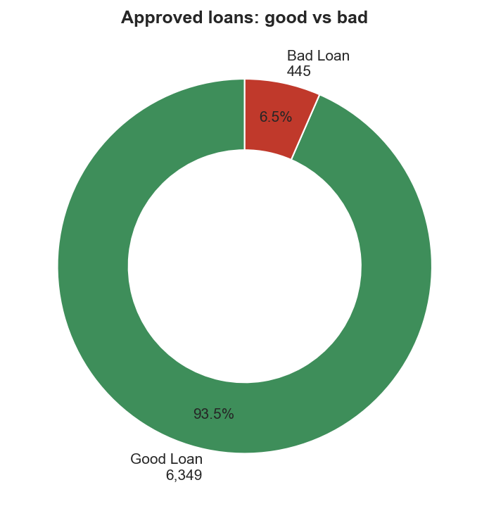
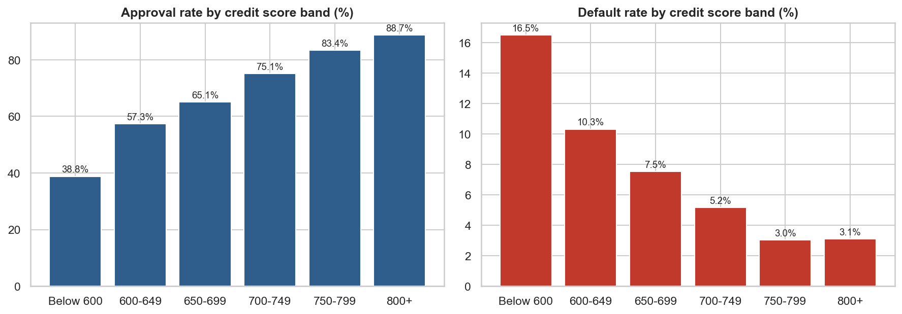
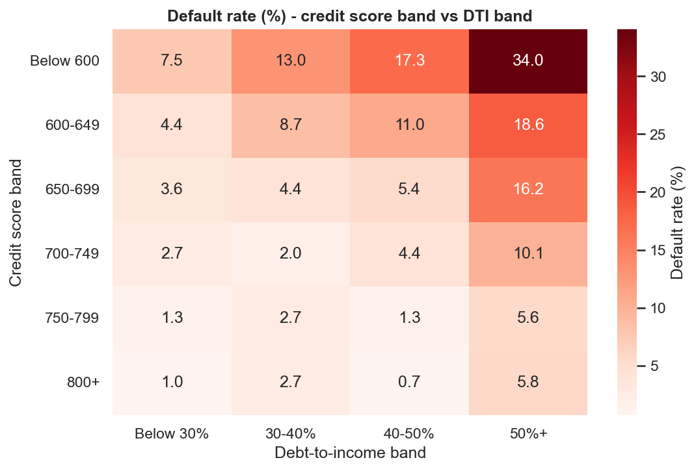

# Project 2 - Bank Loan Analysis

**Tools:** SQL (SQLite) | Python (Pandas, Matplotlib, Seaborn) | Excel (formulas + charts) | Power BI (build guide included)

## Business problem
A bank's credit-risk team wants to know **who gets approved, who defaults, and which customer segments are risky**. Using 10,000 loan applications (2023-2024) I answered:

1. What is the approval rate and how much money was disbursed?
2. What share of approved loans are good (Fully Paid / Current) vs bad (Default)?
3. How do credit score, debt-to-income (DTI) ratio, loan purpose and employment type affect approval and default?
4. Which segment should the bank watch most closely?

## About the data
> **The dataset is synthetic.** Real bank data is confidential, so `src/generate_data.py` (fixed random seed) creates 10,000 applications (10,050 raw rows including duplicates) with realistic relationships: approval and default depend on credit score and DTI, business and personal loans are riskier than home loans, and so on. The findings describe this generated data, not a real bank.

| Column | Meaning |
|---|---|
| loan_id, application_date, state | application details |
| customer_age, employment_type, annual_income, credit_score | applicant profile |
| loan_purpose, loan_amount, tenure_months, interest_rate, emi | loan details (INR) |
| dti_pct | (existing monthly debt + new EMI) / monthly income x 100 |
| application_status | Approved / Rejected |
| repayment_status | Fully Paid / Current / Default / Not Disbursed |
| disbursed_amount | amount paid out (0 if rejected) |

**Data problems injected into the raw file:** duplicate rows, missing annual income, inconsistent state names (`KARNATAKA`, ` delhi `).

## Definitions (used identically in Python, SQL, Excel and Power BI)
- **Approval rate** = approved applications / all applications
- **Good loan** = approved loan that is Fully Paid or Current; **Bad loan** = approved loan in Default
- **Default rate** = bad loans / approved loans
- **DTI band:** Below 30%, 30-40%, 40-50%, 50%+ | **Credit band:** Below 600, 600-649, 650-699, 700-749, 750-799, 800+

## Approach
1. **Clean:** remove duplicates, standardise state names, fill missing income with the median of the same employment type, add credit / DTI / age bands and a good-vs-bad flag.
2. **SQL:** 10 queries (`sql/queries.sql`) for KPIs, risk by credit band and DTI band, purpose portfolio, running totals, state ranking, a credit x DTI risk matrix and a high-risk segment.
3. **Python:** KPIs, 8 charts including a risk heatmap, and auto-generated insights.
4. **Excel:** `excel/loan_analysis.xlsx` - every summary number is a live `COUNTIFS / SUMIFS / AVERAGEIF` formula on the data sheet, with charts.
5. **Power BI:** step-by-step build guide and all DAX measures in `powerbi/`.

## Data cleaning log
| Step | Rows |
|---|---:|
| Rows in raw file | 10,050 |
| Exact duplicate rows removed | 50 |
| Missing annual_income filled with median of employment type | 150 |
| Rows in clean file | 10,000 |

## Key findings
### Portfolio overview
- **10,000** applications received; **67.9%** approved (6,794 loans, Rs 749.09 Cr disbursed, average loan Rs 11.03 L).
- **93.5%** of approved loans are good (Fully Paid or Current) and **6.5%** are in default; defaulted loans hold **5.8%** of the disbursed amount.
- Home loans are the largest book (Rs 355.60 Cr); Maharashtra is the top state (Rs 169.06 Cr).

### What drives approval and default
- Approval rate climbs from **38.8%** for scores below 600 to **88.7%** for 800+.
- Default rate falls from **16.5%** (score below 600) to **3.1%** (800+).
- Default rate rises with debt burden: **3.1%** when DTI is below 30% vs **11.9%** when DTI is 50% or more.
- Business loans default most (11.4%), Education loans least (3.3%).
- Freelancer borrowers default most (10.7%); Business Owner borrowers least (5.2%).

### High-risk segment
- Approved loans with credit score below 650 **and** DTI of 40% or more make up **9.2%** of approved loans but default at **18.2%** vs **5.4%** for everyone else.

### Recommendations
1. Add a stricter review (or a higher interest rate / lower limit) for applicants with credit score < 650 and DTI >= 40%.
2. Use DTI bands, not only credit score, in approval rules - the heatmap shows both matter together.
3. Monitor Business and Freelancer segments more closely with early-warning follow-ups.
4. Track good-loan % and default rate monthly on the dashboard so risk changes are visible early.

## Selected charts




## Project structure
```
02-bank-loan-analysis/
├── data/raw/loan_data_raw.csv
├── data/processed/loan_data_clean.csv
├── sql/queries.sql                  10 queries
├── src/generate_data.py             synthetic data
├── src/analysis.py                  cleaning, KPIs, charts, insights
├── src/run_sql.py                   runs the SQL file on SQLite
├── src/build_excel.py               builds the Excel workbook with formulas
├── excel/loan_analysis.xlsx
├── powerbi/                         DAX measures + dashboard build guide
└── outputs/                         charts, kpis.json, insights.md, sql_results/
```

## How to run
```bash
pip install -r ../requirements.txt openpyxl
python src/generate_data.py
python src/analysis.py
python src/run_sql.py
python src/build_excel.py      # optional: rebuilds the Excel file
```
(When `build_excel.py` writes the workbook, open it in Excel once so the formulas calculate and display values.)

## Limitations and next steps
- Synthetic data: no fraud, no macro-economic effects, and DTI values are higher than most banks would allow.
- Default here is a simple flag; a real credit-risk model would use time-to-default (survival analysis) or a scorecard.
- Next: fit a logistic regression on credit score, DTI, purpose and employment to score new applicants.
